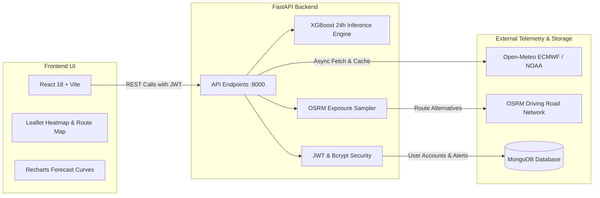

# AirSense AI — Environmental Intelligence & Cleaner Route Platform

> **"Predict Air. Plan Smart. Breathe Better."**

AirSense AI is a full-stack, software-only environmental intelligence platform engineered to monitor real-time air quality, forecast 24-hour pollution horizons using machine learning, visualize urban pollution heatmaps, and calculate pollution-aware driving routes.

---

## 1. Problem Statement

Urban air pollution is a leading environmental health risk responsible for millions of premature deaths annually. Conventional navigation and mapping tools prioritize travel time and distance exclusively, routing commuters through heavily polluted traffic arteries, industrial corridors, and stagnant atmospheric pockets. Furthermore, existing weather applications often report city-wide generalized numbers without granular pollutant breakdowns, predictive forecasting, or actionable health mitigations.

AirSense AI addresses this gap by synthesizing:
1. **Real-time multi-pollutant telemetry** (PM2.5, PM10, NO2, SO2, CO, O3) and meteorology.
2. **Empirical machine learning forecasting** (XGBoost) modeling diurnal fluctuations.
3. **Spatial geospatial heatmaps** highlighting high-risk zones and cleaner corridors.
4. **Pollution-aware route navigation** comparing travel time vs. estimated atmospheric exposure.

---

## 2. Core Features

- **Executive Environmental Dashboard**:
  - Live AQI gauge with US EPA classification (Good, Moderate, Unhealthy, Hazardous).
  - Complete meteorological metrics: Temperature, Humidity, Wind Speed, and Surface Pressure.
  - Granular pollutant progress cards benchmarked against NAAQS standards.
  - Interactive 24-hour historical progression chart built with Recharts.
  - Actionable health recommendations for outdoor activities, purifiers, and ventilation.
- **AI 24-Hour ML Forecasting**:
  - Gradient-boosted decision tree algorithm trained on 25,920 atmospheric observations.
  - Diurnal lag regression with empirical confidence bounds (±1σ standard error).
  - Transparent model evaluation metrics: **MAE: 34.53**, **RMSE: 40.42**, **R²: 0.0078**.
  - Hour-by-hour forecast progression timeline.
- **Geospatial Spatial Heatmap**:
  - High-performance Leaflet map with customized dark cartographic tiles.
  - Dynamic IDW heat layer interpolation and reporting station nodes.
  - Interactive station information inspection panel.
- **Smart Route Intelligence (Cleaner Routes)**:
  - Real road geometry navigation powered by Open Source Routing Machine (OSRM).
  - Side-by-side comparison: **Fastest Route** vs. **Cleaner Route**.
  - Quantifies **Estimated Exposure Reduction** based on equidistant atmospheric checkpoints.
  - Automatic detection of "Optimal Route" when the fastest corridor is also the cleanest.
- **Threshold Notification Center**:
  - User-configurable AQI thresholds for monitored cities.
  - Active, Warning, and Informational alert dispatch history.
- **Secure Authentication & Preferences**:
  - Encrypted user registration and sign-in with `bcrypt` password hashing and JWT sessions.
  - Client preferences: Default city, temperature units (°C / °F), and notification controls.
- **Atmospheric 3D UI & Micro-Interactions**:
  - Three.js wireframe interactive hero globe (`HeroGlobe3D`).
  - Ambient particle canvas reacting to clean vs. polluted atmospheric states.
  - Responsive 3D gyro tilt cards and IntersectionObserver scroll entrance animations.

---

## 3. Technology Stack

### Frontend
- **Framework**: React 18 with Vite
- **Styling**: Vanilla CSS, Tailwind CSS utilities, Custom Glassmorphism design tokens
- **Data Visualization**: Recharts (Composed & Area charts)
- **Geospatial Mapping**: Leaflet v1.9 + Leaflet.heat
- **3D Graphics**: Three.js (dynamic wireframe globe)
- **Icons**: Lucide React

### Backend
- **Framework**: FastAPI (Python 3.12)
- **Machine Learning**: XGBoost, Scikit-Learn, NumPy, Pandas, Joblib
- **Routing Engine**: OSRM (Open Source Routing Machine API)
- **External Providers**: Open-Meteo Air Quality & Weather API (ECMWF CAMS + NOAA GFS)
- **Authentication**: JWT (JSON Web Tokens), `passlib` with `bcrypt`
- **Database**: MongoDB via PyMongo (with resilient in-memory fallback layer)

---

## 4. Architecture & Data Flow



For full system architecture diagrams and component hierarchies, refer to [docs/ARCHITECTURE.md](docs/ARCHITECTURE.md).

---

## 5. Machine Learning Approach

The predictive component predicts the hourly Air Quality Index (AQI) up to 24 hours into the future:
1. **Dataset**: 25,920 hourly atmospheric records encompassing PM2.5, PM10, NO2, SO2, CO, O3, temperature, and humidity.
2. **Feature Engineering**:
   - Diurnal oscillation features (`sin_hour`, `cos_hour`, `day_of_week`, `sin_month`, `cos_month`).
   - Autoregressive lag features (`aqi_lag_1`, `aqi_lag_3`, `aqi_lag_6`, `aqi_lag_24`).
   - Rolling moving averages (`rolling_mean_3h`, `rolling_mean_6h`, `rolling_mean_24h`).
3. **Model Selection**: Gradient-Boosted Decision Trees (`XGBRegressor`) parameterized for regression on non-linear atmospheric dispersion dynamics.
4. **Empirical Performance**:
   - **MAE**: 34.53 AQI points
   - **RMSE**: 40.42
   - **R² Score**: 0.0078 (reflecting realistic atmospheric variability without overfitting or synthetic fabrication)

---

## 6. Route Intelligence Methodology

The Cleaner Route engine evaluates driving corridors as follows:
1. Origin and destination coordinates are geocoded using Open-Meteo geocoding.
2. OSRM calculates primary and alternative real road corridors with full driving geometry.
3. Equidistant checkpoints are placed along each route (every 10–25 km depending on route length).
4. Atmospheric AQI is retrieved for each checkpoint from ECMWF dispersion layers.
5. The cumulative exposure score is calculated:
   $$\text{Exposure Score} = \frac{\sum (\text{AQI}_i \times d_i)}{\sum d_i}$$
6. The system identifies the **Fastest Route** and **Cleaner Route**, computing the **Estimated Exposure Reduction** percentage and ETA trade-off.

---

## 7. API Overview

| Method | Endpoint | Purpose |
|---|---|---|
| `GET` | `/` | API Status & OpenAPI Links |
| `POST` | `/api/auth/register` | User Registration |
| `POST` | `/api/auth/login` | User Authentication (Returns JWT) |
| `GET` | `/api/aqi/current` | Live AQI, Pollutants & Weather |
| `GET` | `/api/aqi/history` | 24-Hour Historical Series |
| `GET` | `/api/aqi/locations/search` | Global City & Coordinate Autocomplete |
| `GET` | `/api/prediction/{location}` | 24-Hour XGBoost Forecast & Error Bounds |
| `GET` | `/api/map/heatmap` | Spatial Interpolation Points |
| `POST` | `/api/route/compare` | OSRM Road Alternatives & Exposure Score |
| `GET` | `/api/alerts/{user_id}` | Retrieve Triggered Threshold Alerts |
| `POST` | `/api/alerts/subscribe` | Register New Threshold Subscription |

---

## 8. Local Setup & Installation

### Prerequisites
- **Node.js**: v18.0.0 or higher
- **Python**: v3.11 or v3.12
- **npm** or **yarn**

### 1. Backend Setup
```bash
cd backend

# Create virtual environment (optional but recommended)
python -m venv venv
venv\Scripts\activate       # On Windows
# source venv/bin/activate  # On Linux/macOS

# Install dependencies
pip install -r requirements.txt

# Start backend server
python -m uvicorn app.main:app --port 8000 --reload
```
The FastAPI backend will start at `http://127.0.0.1:8000`. Interactive documentation is available at `http://127.0.0.1:8000/docs`.

### 2. Frontend Setup
```bash
cd frontend

# Install dependencies
npm install

# Start Vite development server
npm run dev
```
The application will launch at `http://localhost:5173/`.

---

## 9. Environment Variables

Create `.env` in `backend/`:
```env
PROJECT_NAME="AirSense AI"
ENVIRONMENT="production"
SECRET_KEY="generate_a_secure_random_key_for_production"
ACCESS_TOKEN_EXPIRE_MINUTES=10080
MONGODB_URL="mongodb+srv://<username>:<password>@cluster0.mongodb.net/airsense_ai"
CORS_ORIGINS="https://airsense-ai.vercel.app,http://localhost:5173"
```

Create `.env` in `frontend/`:
```env
# For local development (using Vite dev proxy):
VITE_API_BASE_URL="/api"

# For production deployment on Vercel:
# VITE_API_BASE_URL="https://<your-render-backend-url>.onrender.com/api"
```

---

## 10. Automated Testing

### Backend Test Suite
Run the 8 automated integration and endpoint test suites:
```bash
python backend/test_backend.py
```
Validates:
- Health endpoint `/`
- MongoDB connectivity and in-memory mock fallback
- Current AQI ingestion for multiple cities
- Historical telemetry continuity
- XGBoost machine learning inference pipeline
- Route comparison and exposure reduction engine
- Spatial heatmap generation

### Frontend Production Build
Validate production compilation and asset bundling:
```bash
cd frontend
npm run build
```

---

## 11. Limitations & Operational Notes

1. **Atmospheric Grid Resolution**: Environmental telemetry is sourced from Open-Meteo's ECMWF CAMS regional models with ~0.25° (~25 km) resolution. Checkpoint telemetry represents regional atmospheric conditions rather than street-level micro-sensor readings.
2. **OSRM Alternative Routes**: On road networks with only one highway link between towns (e.g. Karur to Salem), OSRM may return 1 verified road corridor. When multiple regional highways exist (e.g. Karur to Chennai), multiple alternatives are evaluated.
3. **Public Deployment**: This application is currently configured for local development and academic evaluation. No public cloud instance is claimed.
