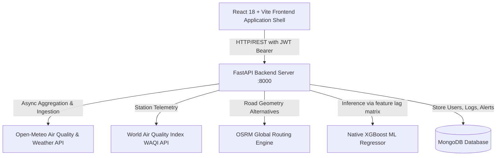
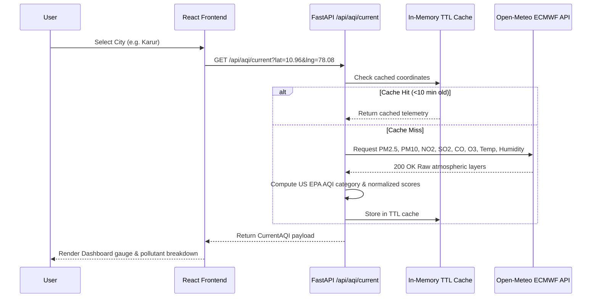
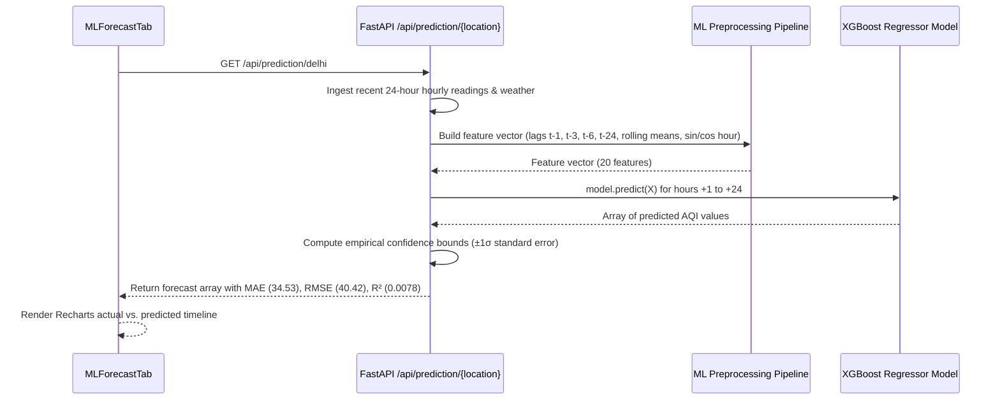
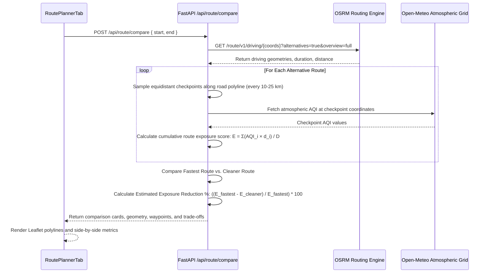

# AirSense AI — System Architecture & Technical Specification

AirSense AI is a software-only atmospheric intelligence and environmental navigation platform. It continuously ingests real-time atmospheric data, generates 24-hour predictive horizons using an XGBoost regression model, interpolates spatial multi-station heatmaps via Leaflet, and computes pollution-aware driving routes using Open Source Routing Machine (OSRM) road corridors.

---

## 1. High-Level System Architecture



---

## 2. Frontend Architecture

The frontend is built with **React 18** and **Vite**, adopting a dark-first environmental design system styled with **Vanilla CSS** and **Tailwind CSS utilities**.

### Component Hierarchy

```text
frontend/src/
├── App.jsx                     # Top-level shell managing auth state, active location, and navigation
├── index.css                   # Core tokens, glassmorphism utilities, and keyframe animations
├── services/
│   └── api.js                  # Axios client with JWT interceptor and global fallback handlers
└── components/
    ├── 3D/                     # Performant 3D & canvas elements
    │   ├── HeroGlobe3D.jsx     # Three.js interactive wireframe globe
    │   ├── AirParticlesBackground.jsx # HTML5 2D ambient atmospheric particles canvas
    │   ├── Card3DTilt.jsx      # Gyro/mouse 3D perspective tilt container
    │   ├── FloatingAQISphere.jsx # Layered glassmorphic AQI status sphere
    │   └── ScrollReveal.jsx    # IntersectionObserver-based entrance animations
    ├── Navigation/             # Application Shell Navigation
    │   ├── Sidebar.jsx         # Desktop responsive sidebar (Branding, Tabs, Settings, Logout)
    │   └── BottomNav.jsx       # Mobile sticky bottom dock (Home, Forecast, Map, Route, Alerts)
    ├── Navbar.jsx              # Global header with Search, Alerts shortcut, and User Profile
    ├── Landing/
    │   └── LandingPage.jsx     # SaaS presentation page with real telemetry and capability cards
    ├── Auth/
    │   ├── LoginPage.jsx       # 2-column desktop authentication layout with validation
    │   └── RegisterPage.jsx    # 2-column registration layout with dynamic password strength meter
    ├── Dashboard/
    │   └── DashboardTab.jsx    # Overview: Live AQI gauge, Weather, Pollutants, Recharts trend, and Module links
    ├── Charts/
    │   └── MLForecastTab.jsx   # 24-hour predictive chart with empirical error bounds & model metrics
    ├── HeatMap/
    │   └── HeatMapTab.jsx      # Leaflet geospatial heatmap, station nodes, and detail inspection
    ├── RoutePlanner/
    │   └── RoutePlannerTab.jsx # Real road geometry routing, side-by-side comparison, and waypoint analysis
    ├── Alerts/
    │   └── AlertsTab.jsx       # Configurable threshold notifications center with Active/Warning/Info tags
    ├── Settings/
    │   └── SettingsTab.jsx     # Profile management, temperature units (°C/°F), and default city preferences
    └── Search/
        └── GlobalCitySearch.jsx # Autocomplete geocoding search for worldwide cities and coordinates
```

---

## 3. Backend Architecture

The backend is built with **FastAPI (Python 3.12)** organized into clean modular service providers:

```text
backend/app/
├── main.py                     # FastAPI application factory, CORS middleware, and API router mounts
├── config.py                   # Pydantic BaseSettings, environment variables, and JWT configuration
├── db/
│   ├── mongo_client.py         # PyMongo client wrapper with automatic fallback mocking if offline
│   └── schemas.py              # Pydantic schemas for User, Alert, Reading, and Prediction
├── api/
│   ├── routes_auth.py          # /api/auth/register, /api/auth/login, /api/auth/me
│   ├── routes_aqi.py           # /api/aqi/current, /api/aqi/history, /api/aqi/locations/search
│   ├── routes_prediction.py    # /api/prediction/{location_id} (24-hour ML inference)
│   ├── routes_map.py           # /api/map/heatmap (Multi-node spatial raster points)
│   ├── routes_route.py         # /api/route/compare (OSRM road geometry + Open-Meteo AQI checkpoints)
│   └── routes_alerts.py        # /api/alerts/subscribe, /api/alerts/{user_id}
├── ml/
│   ├── models/
│   │   ├── xgboost_aqi_model.pkl # Serialized trained XGBoost Regressor
│   │   └── metrics.json        # Empirical metrics (MAE: 34.53, RMSE: 40.42, R²: 0.0078)
│   ├── preprocess.py           # Temporal lag and rolling feature matrix generation
│   ├── train_xgboost.py        # Training pipeline on 25,920 atmospheric observations
│   └── evaluate.py             # Validation and error metric computation
└── services/
    ├── aqi_fetcher.py          # Multi-provider coordinator (Open-Meteo + WAQI fallback)
    ├── prediction_service.py   # Machine learning inference runner with empirical bounds
    ├── route_service.py        # OSRM driving engine & equidistant route segment sampler
    ├── alert_service.py        # Alert threshold evaluation engine
    └── providers/
        ├── open_meteo_provider.py # Open-Meteo Air Quality ECMWF model client
        ├── weather_service.py  # Open-Meteo weather client (temp, humidity, wind, pressure)
        └── geocoding_service.py# Worldwide city name to lat/lng geocoding
```

---

## 4. API Layer Specification

All API endpoints are prefixed with `/api` and return standardized JSON responses:

| Method | Endpoint | Description | Auth Required |
|---|---|---|---|
| `GET` | `/` | API Health and OpenAPI documentation links | No |
| `POST` | `/api/auth/register` | Create user account with bcrypt hashed password | No |
| `POST` | `/api/auth/login` | Authenticate credentials and return JWT bearer token | No |
| `GET` | `/api/auth/me` | Return currently authenticated user profile | Yes (JWT) |
| `GET` | `/api/aqi/current` | Retrieve live AQI and pollutants for coordinates/city | No |
| `GET` | `/api/aqi/history` | Retrieve 24-hour historical telemetry series | No |
| `GET` | `/api/aqi/locations/search` | Search cities and geographic coordinates worldwide | No |
| `GET` | `/api/prediction/{location_id}` | Generate 24-hour XGBoost AQI forecast with confidence bounds | No |
| `GET` | `/api/map/heatmap` | Retrieve spatial monitoring node cluster around coordinates | No |
| `POST` | `/api/route/compare` | Fetch real road routes (OSRM) and calculate exposure scores | No |
| `GET` | `/api/alerts/{user_id}` | Fetch active and triggered threshold alerts | No |
| `POST` | `/api/alerts/subscribe` | Register new AQI threshold monitoring alert | No |

---

## 5. Core Data Flows

### A. AQI & Weather Data Flow



### B. Machine Learning Prediction Flow



### C. Cleaner Route Engine Flow



---

## 6. Authentication & Security Architecture

1. **Password Hashing**: User passwords are encrypted using `bcrypt` with salt rounds handled via `passlib`.
2. **JWT Tokens**: Authenticated sessions issue JSON Web Tokens signed with HMAC-SHA256 (`HS256`) and a configured secret key.
3. **Client-Side Storage**: Token and user metadata are stored in `localStorage` under `airsense_token` and `airsense_user`.
4. **Axios Interceptor**: Outgoing requests automatically inject `Authorization: Bearer <token>` when available.
5. **Route Protection**: The application shell restricts authenticated tabs (`dashboard`, `forecast`, `heatmap`, `route`, `alerts`, `settings`) to verified sessions, redirecting unauthenticated visitors to the login view.

---

## 7. Database Architecture (MongoDB)

AirSense AI uses MongoDB via PyMongo. When MongoDB is unavailable locally or in headless test environments, an internal in-memory fallback layer ensures zero runtime crashes.

### Collections:
1. **`users`**:
   - `id` (UUID / ObjectId)
   - `name` (String)
   - `email` (String, Unique index)
   - `password_hash` (String)
   - `created_at` (ISODate)
2. **`alerts`**:
   - `id` (UUID)
   - `user_id` (String)
   - `location_id` (String)
   - `city` (String)
   - `threshold_aqi` (Number)
   - `level` (String: Active | Warning | Informational)
   - `message` (String)
   - `triggered_at` (ISODate)
3. **`readings`**:
   - `location_id` (String)
   - `aqi` (Number)
   - `pollutants` (Subdocument: pm25, pm10, no2, so2, co, o3)
   - `weather` (Subdocument: temp, humidity, wind, pressure)
   - `timestamp` (ISODate)

---

## 8. External Service Integrations

1. **Open-Meteo Air Quality API**:
   - High-resolution atmospheric dispersion modeling (ECMWF CAMS + NOAA GFS).
   - Non-commercial, open-access, zero API key required.
2. **Open Source Routing Machine (OSRM)**:
   - Driving network routing engine built on OpenStreetMap road corridors.
   - Provides turn-by-turn road polylines and alternative highway paths.
3. **OpenStreetMap Tile Server**:
   - Standard cartographic tiles filtered with CSS dark-mode invert matrices for high-contrast environmental visualization.
4. **World Air Quality Index (WAQI)**:
   - Secondary station cluster fallback provider for ground-level sensor nodes.

---

## 9. Performance & Code-Splitting Strategy

- **Lazy Loading**: Heavy 3D assets (`HeroGlobe3D.jsx` using Three.js) and Leaflet plugins (`leaflet.heat`) are dynamically loaded using React `Suspense` and dynamic `import()` to minimize initial bundle size.
- **Vendor Splitting**: Configured in Vite (`vite.config.js`) to produce discrete chunks:
  - `three-vendor.js` (~517 kB)
  - `recharts-vendor.js` (~547 kB)
  - `leaflet-vendor.js` (~149 kB)
  - `index.js` application bundle (~251 kB)
- **TTL In-Memory Caching**: Open-Meteo weather and air quality responses are cached for 10 minutes (600s) to prevent redundant upstream network calls.

---

## 10. Verification & Quality Assurance

- **Backend Automated Test Suite**: Validated via `python backend/test_backend.py` covering health endpoints, database connection resilience, AQI retrieval, ML predictions, route comparisons, and spatial heatmap generation.
- **Frontend Production Compilation**: Validated via `npm run build` using the Vite bundler with zero compiler errors.
